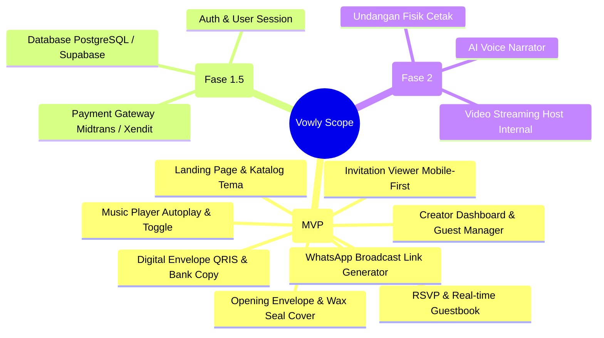

# Business Requirements Document (BRD)
## Project: SCIVING - Digital Wedding Invitation SaaS Platform

---

### 1. Eksekutif & Latar Belakang (Executive Summary)
Pasar pernikahan di Indonesia mengalami pergeseran paradigma yang signifikan dari undangan fisik cetak (*paper invitation*) menuju undangan pernikahan digital berbasis web (*digital wedding invitation*). Faktor pendorong utamanya adalah:
- **Efisiensi Biaya:** Biaya cetak dan ongkos kirim fisik undangan kertas konvensional berkisar antara Rp 5.000 – Rp 25.000 per lembar untuk 300–1.000 tamu (total Rp 1.500.000 – Rp 25.000.000).
- **Kecepatan & Kepraktisan:** Kemudahan distribusi via WhatsApp dan media sosial dalam hitungan menit tanpa batasan geografis.
- **Interaktivitas:** Undangan web mendukung fitur modern seperti peta GPS, hitung mundur, pemutar musik romantis, RSVP real-time, dan amplop digital (QRIS & transfer bank).

**SCIVING** (Solusi Cerdas Infratech) hadir sebagai platform *self-service digital wedding invitation SaaS* yang menargetkan calon pengantin modern di Indonesia dengan mengutamakan **estetika mewah, kemudahan personalisasi nama tamu, integrasi broadcast WhatsApp instan, serta model penetapan harga transparan (*one-time purchase*)**.

---

### 2. Tujuan Bisnis (Business Objectives)
1. **Time-to-Publish Instan:** Pengguna dapat membuat dan menyebarkan undangan digital siap pakai dalam waktu kurang dari 15 menit.
2. **Tingkat Adopsi & Viralitas Tinggi:** Setiap undangan yang disebarkan ke ratusan tamu berfungsi sebagai kanal akuisisi organik (*viral loop*) melalui *watermark* halus "Dibuat dengan Vowly".
3. **Konversi RSVP Optimal:** Membantu pasangan menghemat biaya katering dengan mengumpulkan konfirmasi kehadiran akurat hingga >70% tamu.
4. **Target Pendapatan:** Mencapai *Gross Merchandise Value* (GMV) yang stabil dengan menjual paket undangan seharga Rp 99.000 – Rp 199.000 per acara.

---

### 3. Profil Pengguna & Persona (Target Audience & Personas)

| Persona | Profil & Karakteristik | Kebutuhan Utama | Rasa Frustrasi Saat Ini (*Pain Points*) |
| :--- | :--- | :--- | :--- |
| **Calon Mempelai (Primary)** | Usia 22–35 tahun, tech-savvy, aktif di Instagram/TikTok, merencanakan pernikahan. | Desain yang estetik, tidak pasaran, musik romantis, amplop digital yang gampang disalin, dan cara sebar WA yang praktis. | Sulit mengedit template, sistem ribet, biaya langganan bulanan yang tidak masuk akal, atau tampilan web lemot di HP tamu. |
| **Tamu Undangan (Consumer)** | Keluarga, teman, rekan kerja lintas usia (18–65 tahun) yang menerima link di WhatsApp. | Website cepat dibuka di HP, nama mereka tertera dengan sopan, tombol buka maps jelas, amplop transfer mudah. | Link lambat, tampilan berantakan di layar kecil, iklan pop-up mengganggu, atau sulit mencari lokasi acara. |
| **Wedding Organizer (Secondary)** | Event planner / vendor pernikahan yang menangani banyak klien pengantin per bulan. | Dashboard manajemen banyak acara (*multi-client*), opsi kustomisasi cepat, dan ekspor data RSVP ke Excel. | Harus membuat website dari awal untuk setiap klien; tidak ada rekap kehadiran terpusat. |

---

### 4. Analisis Kompetitif (Competitive Landscape)

| Fitur / Dimensi | Felaria.app | Platform Konvensional (WordPress/Plugins) | **Vowly (Versi Kita)** |
| :--- | :--- | :--- | :--- |
| **Model Pembayaran** | Sekali bayar (~Rp 100.000) | Langganan / Jasa Desain Custom (Rp 300k - 1jt) | **Sekali bayar (Rp 99.000) + paket add-on** |
| **Kecepatan Muat (Mobile)** | Baik | Sedang - Berat (banyak plugin WordPress) | **Sangat Cepat (Next.js SSR + Static Optimization)** |
| **Personalisasi Tamu** | Parameter URL nama tamu | Sebagian mendukung | **Dynamic parameter (`?to=...`) + generator draf WA** |
| **Koleksi Tema** | Editorial, Sealed, Sore | Bervariasi, sering kali kaku | **Luxury Sealed Wax, Editorial Vogue, Floral Sekar** |
| **Amplop Digital** | Bank & QRIS statis | Rekening teks biasa | **1-klik Salin Rekening + Modal QRIS interaktif + Kado Fisik** |
| **Manajemen Broadcast** | Dashboard WA link | Manual satu per satu | **Dashboard Tamu + Filter Kategori + Tombol Kirim WA Instan** |

---

### 5. Model Monetisasi & Strategi Penetapan Harga (Revenue Model)

1. **Paket Dasar (Rp 99.000 / Undangan):**
   - 1 Website undangan aktif selama 12 bulan.
   - Akses seluruh fitur standar: Musik, Countdown, Google Maps, RSVP, Buku Ucapan, Amplop Digital.
   - Personalisasi nama tamu tanpa batasan kuota tamu.
2. **Paket Premium / Add-On (Opsional - Tahap 2):**
   - *Custom Domain*: Menggunakan domain sendiri (contoh: `radityasekar.com`) seharga +Rp 150.000.
   - *WhatsApp Blasting Otomatis*: Integrasi WhatsApp Gateway resmi untuk pengiriman massal sekali klik (+Rp 50.000 / 300 tamu).
   - *Check-in QR Code Scanner*: Scanner tamu di meja resepsionis hari H (+Rp 75.000).

---

### 6. Cakupan Proyek (Project Scope)

---

### 7. Indikator Keberhasilan Bisnis (Key Success Metrics / KPIs)
1. **Conversion Rate Landing Page:** Target > 4.5% pengunjung yang mencoba demo / mendaftar.
2. **RSVP Response Rate:** > 65% tamu yang membuka undangan mengisi konfirmasi kehadiran.
3. **Viral Coefficient ($K$-Factor):** $K > 1.2$, di mana setiap 1 undangan yang aktif menghasilkan minimal 1–2 pengguna baru yang membuat undangan setelah melihat tanda *watermark*.
4. **Page Load Time:** < 2.0 detik pada jaringan 4G seluler.

