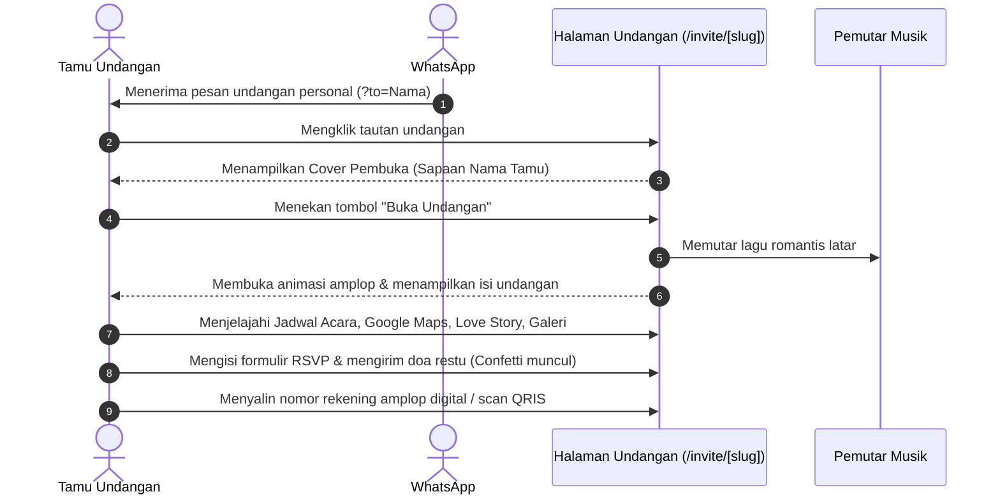
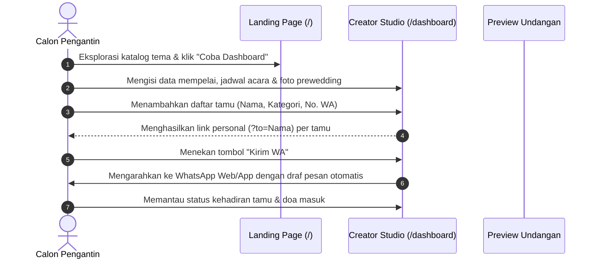

# Product Requirements Document (PRD)
## Project: SCIVING - Digital Wedding Invitation Platform

---

### 1. Visi Produk (Product Vision)
Memberikan pengalaman pembuatan dan penerimaan undangan pernikahan digital yang paling berkesan, elegan, dan tanpa hambatan di Indonesia, menggabungkan kemewahan visual tradisional dengan teknologi web modern yang cepat dan mudah dibagikan.

---

### 2. Alur Pengguna (User Journeys)

#### A. Alur Tamu Undangan (Guest Journey)

#### B. Alur Calon Pengantin / Kreator (Creator Journey)

---

### 3. Kebutuhan Fungsional (Functional Requirements)

#### FR-01: Landing Page & Showcase Katalog
- **Deskripsi:** Halaman publik yang memamerkan produk, nilai tambah, katalog tema, harga, dan FAQ.
- **Kriteria Penerimaan (Acceptance Criteria):**
  - [x] Menampilkan navigasi utama yang responsif.
  - [x] Menampilkan tombol CTA *"Lihat Contoh Undangan Jadi"* dan *"Coba Dashboard Pembuat"*.
  - [x] Menyajikan katalog tema (Sealed Luxury, Editorial Vogue, Sekar Floral) dengan tombol *Live Preview*.
  - [x] Menampilkan rincian harga paket transparan sekali bayar (Rp 99.000).

#### FR-02: Cover Pembuka & Personalisasi Tamu (Opening Cover)
- **Deskripsi:** Layar pertama yang dilihat tamu sebelum masuk ke konten utama.
- **Kriteria Penerimaan:**
  - [x] Membaca parameter query URL `?to=[nama_tamu]`. Jika tidak ada, fallback ke *"Bapak/Ibu/Saudara/i"*.
  - [x] Menampilkan badge *"Undangan Khusus"*, nama tamu dalam tipografi elegan, dan tombol *"Buka Undangan"*.
  - [x] Saat tombol ditekan, cover meluncur ke atas (*smooth slide up & fade out*) dan memicu pemutaran audio.

#### FR-03: Pemutar Musik Latar (Music Player)
- **Deskripsi:** Audio player melayang yang memutar lagu kenangan mempelai.
- **Kriteria Penerimaan:**
  - [x] Tombol mengambang di pojok kanan atas dengan animasi piringan berputar saat aktif.
  - [x] Tamu dapat melakukan *toggle* jeda (pause) atau putar kembali (play) kapan saja.
  - [x] Kompatibel dengan kebijakan *autoplay* browser modern (dimulai pasca-interaksi klik *"Buka Undangan"*).

#### FR-04: Rangkaian Acara & Integrasi Navigasi
- **Deskripsi:** Informasi detail acara Akad Nikah dan Resepsi.
- **Kriteria Penerimaan:**
  - [x] Menampilkan hari, tanggal, jam, nama gedung, dan alamat lengkap.
  - [x] Tombol *"Petunjuk Arah (Maps)"* yang membuka Google Maps langsung ke koordinat/lokasi gedung.
  - [x] Tombol *"Simpan Kalender"* yang menghasilkan tautan Google Calendar otomatis dengan judul, tanggal, dan lokasi acara yang sudah terisi.

#### FR-05: Galeri Foto & Lightbox Modal
- **Deskripsi:** Koleksi foto kebersamaan kedua mempelai.
- **Kriteria Penerimaan:**
  - [x] Tampilan grid foto responsif (2 kolom di mobile, 3 kolom di desktop).
  - [x] Klik pada foto memunculkan modal *lightbox* berlatar gelap transparan dengan tombol tutup (*X*) atau klik di luar area modal.

#### FR-06: Amplop Digital & QRIS Instan
- **Deskripsi:** Fasilitas pengiriman tanda kasih secara *cashless*.
- **Kriteria Penerimaan:**
  - [x] Menampilkan nama bank, logo/nama, nomor rekening, dan nama pemilik rekening.
  - [x] Tombol *"Salin Rekening"* yang langsung menyalin teks ke *clipboard* dan memberikan umpan balik visual *"Tersalin!"*.
  - [x] Tombol QRIS yang menampilkan pop-up barcode QRIS siap scan.
  - [x] Opsi alamat pengiriman kado fisik lengkap dengan tombol salin alamat.

#### FR-07: Formulir RSVP & Buku Tamu (Wishes)
- **Deskripsi:** Form konfirmasi kehadiran dan pengiriman pesan doa restu.
- **Kriteria Penerimaan:**
  - [x] Input: Nama lengkap, Hubungan/Kerabat, Pilihan Kehadiran (Akan Hadir / Masih Ragu / Berhalangan), Jumlah Tamu (Pax), dan Pesan Ucapan.
  - [x] Saat formulir dikirim, memicu animasi perayaan konfeti (*canvas-confetti*).
  - [x] Pesan baru langsung muncul di daftar buku tamu teratas secara instan.

#### FR-08: Studio Pengantin & Generator Pesan WhatsApp (/dashboard)
- **Deskripsi:** Panel kendali pasangan untuk mengelola tamu dan menyebarkan undangan.
- **Kriteria Penerimaan:**
  - [x] Ringkasan metrik: Total Tamu, Konfirmasi Hadir, Ucapan Masuk, Undangan Terkirim.
  - [x] Tambah tamu baru dengan input Nama, No. HP, dan Kategori (VIP, Keluarga, Teman, Rekan Kerja).
  - [x] Fitur pencarian tamu dan filter berdasarkan kategori.
  - [x] Tombol *"Kirim WA"* yang langsung membuka WhatsApp Web / Aplikasi WA dengan pesan sopan yang telah dirangkai otomatis beserta tautan personal tamu.

---

### 4. Kebutuhan Non-Fungsional (Non-Functional Requirements / NFR)

| ID | Parameter | Spesifikasi & Standar |
| :--- | :--- | :--- |
| **NFR-01** | **Performa & Kecepatan** | *Largest Contentful Paint* (LCP) < 2.0s, First Input Delay (FID) < 100ms, Cumulative Layout Shift (CLS) < 0.1 pada jaringan 4G. |
| **NFR-02** | **Responsivitas Layar** | Tampilan wajib optimal di resolusi *viewport* 320px, 375px, 414px (mobile), 768px (tablet), dan 1024px+ (desktop). |
| **NFR-03** | **Aksesibilitas (WCAG 2.1 AA)** | Kontras warna teks minimal 4.5:1, seluruh tombol memiliki label ARIA, navigasi dapat diakses menggunakan *keyboard*. |
| **NFR-04** | **SEO & Social Sharing Preview** | Mendukung tag Open Graph (`og:title`, `og:description`, `og:image`) dinamis agar pratinjau tautan di WhatsApp, Telegram, dan iMessage muncul dengan foto dan teks yang menarik. |
| **NFR-05** | **Keandalan (Reliability)** | Uptime target 99.9%, tahan terhadap lonjakan akses ribuan tamu secara bersamaan di hari H pernikahan. |

