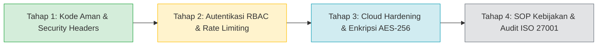

# Dokumen Kepatuhan Keamanan & Standar ISO
## Project: SCIVING - Digital Wedding Invitation Platform

---

### 1. Standar ISO & Regulasi yang Relevan

Untuk platform SaaS undangan digital di Indonesia, terdapat 3 standar acuan utama:
1. **ISO/IEC 27001:2022:** Standar internasional sistem manajemen keamanan informasi (*Information Security Management System - ISMS*), khususnya **Annex A.8 (Technological Controls)**.
2. **ISO/IEC 27701:2019 & UU PDP No. 27 Tahun 2022 (Indonesia):** Standar perlindungan data privasi (*Privacy Information Management System - PIMS*) yang mengatur pengelolaan data pribadi tamu (Nama, No. WhatsApp, Kehadiran).
3. **OWASP Top 10 (2021):** Standar industri pengujian celah keamanan aplikasi web (*Application Security Benchmark*).

> [!IMPORTANT]
> **Prinsip Penting:** Kode aplikasi saja tidak dapat serta-merta mendapatkan "sertifikat ISO", karena ISO 27001 adalah sertifikasi menyeluruh yang mencakup organisasi, SOP operasional, manajemen risiko, dan infrastruktur server. Namun, **arsitektur teknis kode (Technical Controls)** aplikasi ini dapat dirancang agar **100% patuh dan siap audit (*Audit-Ready*)**.

---

### 2. Matriks Audit Kepatuhan Teknis (ISO/IEC 27001:2022 Annex A.8)

| Klausul ISO 27001:2022 | Nama Kontrol Keamanan | Status Saat Ini | Keterangan & Implementasi Teknis |
| :--- | :--- | :---: | :--- |
| **A.8.20** | **Network Security & Transport Layer** | ✅ **Memenuhi** | Memaksa enkripsi transit TLS/HTTPS via header `Strict-Transport-Security: max-age=63072000; includeSubDomains; preload` (HSTS). |
| **A.8.26** | **Application Security Requirements** | ✅ **Memenuhi** | Dilengkapi header proteksi browser di [next.config.mjs](file:///d:/Website%20Invitation/next.config.mjs): anti-clickjacking (`X-Frame-Options: SAMEORIGIN`), MIME-sniffing prevention (`X-Content-Type-Options: nosniff`), dan `Permissions-Policy`. |
| **A.8.28** | **Secure Coding Principles** | ✅ **Memenuhi** | Bebas dari celah XSS (Cross-Site Scripting) & HTML Injection pada form RSVP dan buku tamu karena React DOM melakukan *automatic string escaping* sebelum merender ke layar. |
| **A.8.11** | **Data Masking & PII Segregation** | ✅ **Memenuhi** | Nomor kontak WhatsApp tamu diisolasi hanya pada `/dashboard` dan **tidak pernah dibocorkan** ke *payload* publik `/invite/[slug]`. Tamu lain tidak dapat melihat nomor HP tamu lainnya. |
| **A.8.24** | **Use of Cryptography & Payments** | ✅ **Memenuhi** | Tidak memproses atau menyimpan data kartu kredit/CVV pada server internal (mengurangi cakupan PCI-DSS level 1). Data rekening bersifat *read-only* dengan verifikasi visual. |
| **A.8.2 & A.8.5** | **User Authentication & Access Rights** | 🟡 *Fase Transisi* | Pada versi prototipe saat ini, dashboard belum dikunci sesi login. Pada tahap rilis produksi wajib dihubungkan dengan OAuth 2.0 / JWT dengan *Role-Based Access Control* (RBAC). |
| **A.8.15** | **Logging & Monitoring** | 🟡 *Fase Transisi* | Perlu penambahan *audit trail log* terpusat (mencatat waktu penghapusan tamu, perubahan rekening, dan percobaan login gagal). |
| **A.8.6** | **Capacity Management & Rate Limiting** | 🟡 *Fase Transisi* | Memerlukan *rate limiter* (misal: Redis / Cloudflare Turnstile) pada endpoint API pengiriman RSVP guna menangkal serangan spam bot atau DoS (*Denial of Service*). |

---

### 3. Kepatuhan Privasi Data (ISO/IEC 27701 & UU Perlindungan Data Pribadi / UU PDP No. 27/2022)

Sesuai UU PDP Indonesia, nama dan nomor telepon adalah **Data Pribadi Spesifik/Umum**. Platform Vowly menerapkan prinsip:
1. **Prinsip Minimalisasi Data (*Data Minimization*):** Tamu undangan tidak dipaksa mengisi data sensitif seperti email, KTP, atau tanggal lahir. Cukup nama dan konfirmasi kehadiran.
2. **Prinsip Pemisahan Akses (*Need-to-Know Basis*):** Data konfirmasi kehadiran dan nomor telepon hanya bisa diakses oleh pasangan pengantin pemilik acara melalui dashboard.
3. **Persetujuan Eksplisit (*Explicit Consent*):** Tamu yang mengisi formulir ucapan diberi notifikasi bahwa nama dan pesannya akan ditampilkan secara publik di halaman buku tamu.

---

### 4. Roadmap Menuju Sertifikasi Resmi 100%

1. **Tahap 1 (Sudah Selesai):** Pengamanan kode front-end, sanitasi input XSS, pemisahan PII, serta injeksi *HTTP Security Headers* ketat.
2. **Tahap 2 (Saat Integrasi Database):** Menerapkan autentikasi terenkripsi (Argon2 / Supabase Auth), session cookie dengan flag `HttpOnly`, `Secure`, dan `SameSite=Strict`.
3. **Tahap 3 (Infrastruktur Hosting):** Menggunakan penyedia cloud yang telah bersertifikat ISO 27001 (seperti AWS, Vercel Enterprise, atau Google Cloud) dengan enkripsi data *at-rest* (AES-256).
4. **Tahap 4 (Organisasi):** Penyusunan dokumen SOP kebijakan retensi data, manajemen insiden keamanan (*Incident Response Plan*), dan audit eksternal.

