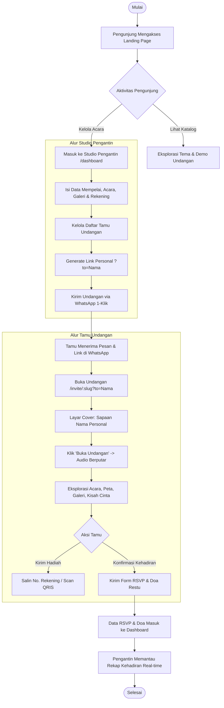
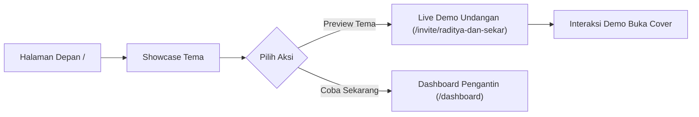
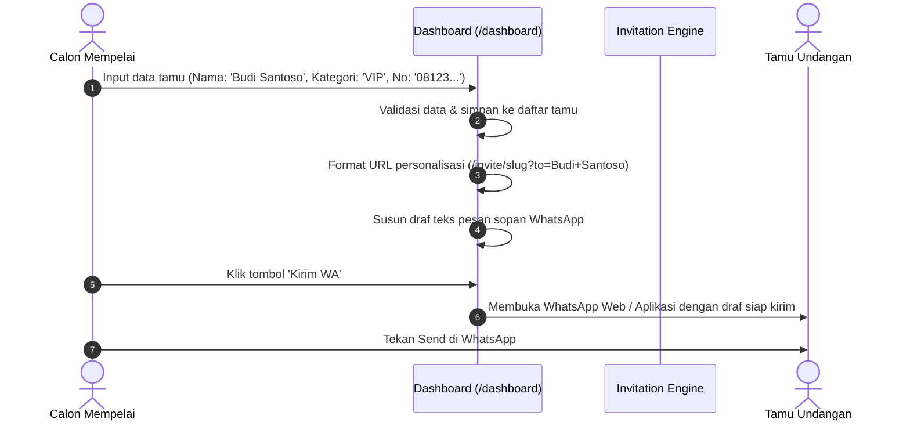
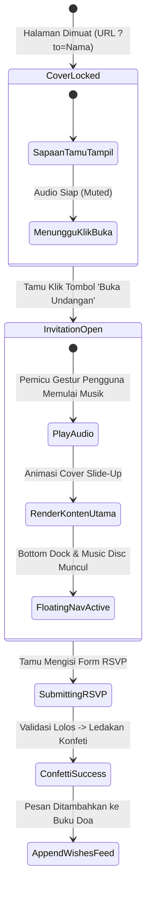
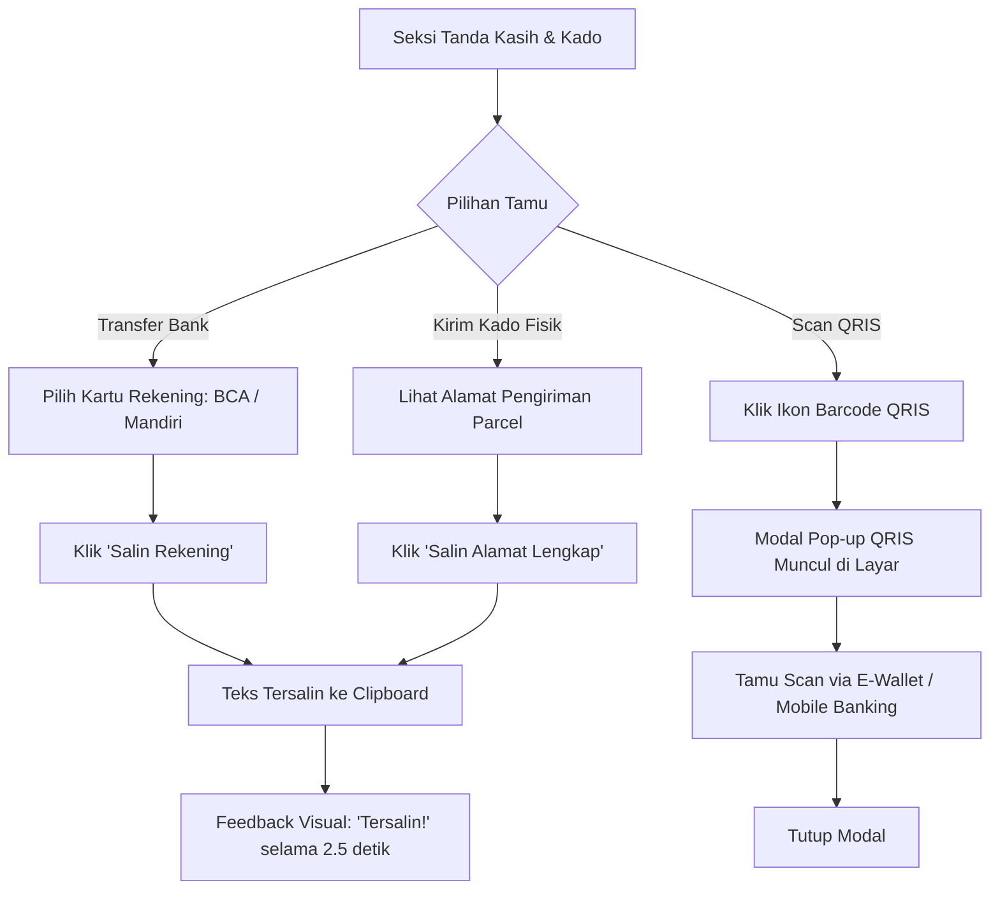
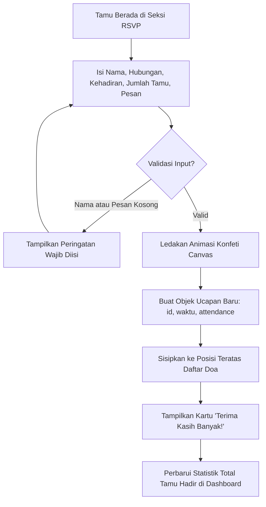

# Alur Sistem & Diagram Proses (System Flow Document)
## Project: SCIVING - Digital Wedding Invitation Platform

Dokumen ini mendokumentasikan seluruh diagram alur kerja (*system workflows*), diagram status (*state diagrams*), serta penanganan kondisi khusus (*edge cases*) pada platform **SCIVING**.

---

## 1. Alur Makro Sistem (High-Level System Lifecycle)

Alur operasional sistem menghubungkan tiga entitas utama: **Pengunjung Publik**, **Calon Mempelai (Kreator)**, dan **Tamu Undangan**.

---

## 2. Alur Rinci per Modul (Detailed Module Flows)

### Flow 1: Alur Halaman Depan & Katalog Tema (Discovery Flow)

* **Tujuan:** Mengonversi pengunjung umum menjadi pengguna aktif.
* **Titik Keputusan:** Pengunjung dapat mencoba demo undangan secara langsung dengan parameter simulasi nama tamu untuk merasakan sensasi penerima undangan.

---

### Flow 2: Alur Studio Pengantin & Manajemen Tamu (Creator Studio Flow)

---

### Flow 3: Siklus Hidup Halaman Undangan Tamu (Guest Viewer State Machine)

Halaman `/invite/[slug]` dikendalikan oleh mesin status (*state machine*) untuk memastikan kesesuaian kebijakan pemblokiran audio otomatis browser:

---

### Flow 4: Alur Amplop Digital & Hadiah Cashless

---

### Flow 5: Alur Konfirmasi Kehadiran (RSVP) & Moderasi Pesan

---

## 3. Penanganan Kondisi Khusus (Edge Cases & Fallback Matrix)

| Skenario (*Edge Case*) | Dampak Potensial | Mekanisme Penanganan Otomatis (*Fallback*) |
| :--- | :--- | :--- |
| **Parameter `?to=` tidak ada di URL** | Cover akan menampilkan teks kosong atau rusak. | Otomatis menampilkan teks *fallback* sopan: `"Bapak/Ibu/Saudara/i"` di cover undangan. |
| **Kebijakan Autoplay Browser Sangat Ketat (iOS)** | Audio gagal berputar saat tombol Buka diklik. | *Promise catch* menangani error tanpa menghentikan animasi pembuka; tombol mengambang *Music Controller* tetap tersedia agar tamu dapat menekan *Play* secara manual. |
| **Tamu Mengakses via Browser Desktop Lebar** | Tampilan mobile bisa terlihat terlalu renggang (*stretched*). | Tata letak menggunakan *container max-w-xl* dan *max-w-4xl* terpusat (*auto margins*) dengan latar bergradasi elegan, menjaga proporsi visual tetap premium. |
| **Koneksi Internet Tamu Lambat** | Foto galeri berat membutuhkan waktu muat lama. | Komponen `Next/Image` menerapkan *lazy loading*, format WebP otomatis, dan rasio dimensi terreservasi untuk mencegah lonjakan pergeseran tata letak (*Cumulative Layout Shift / CLS*). |
| **Nomor WhatsApp Tamu Mengandung Karakter Non-Angka** | Tautan `wa.me` rusak jika ada spasi, strip, atau tanda plus. | Sistem menerapkan pembersihan regex otomatis: `.replace(/[^0-9]/g, "")` sebelum dimasukkan ke dalam skema URL WhatsApp. |
