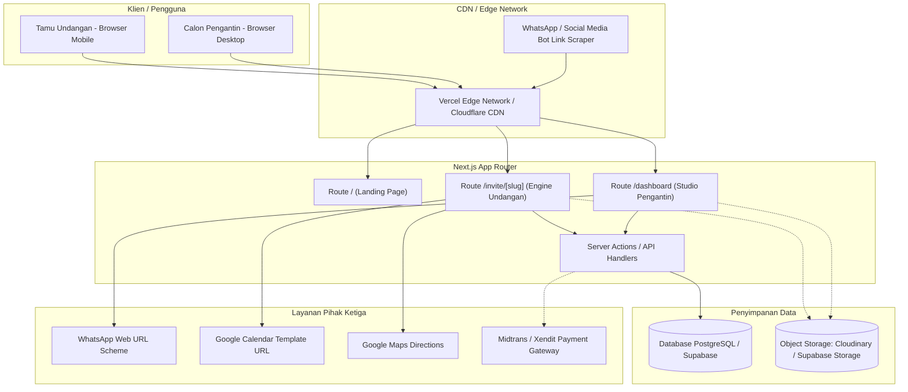
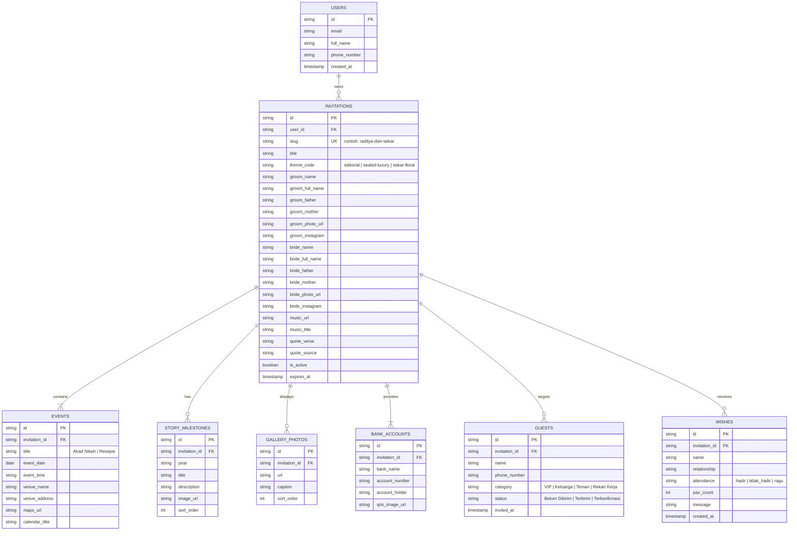

# System Specification & Architecture Document
## Project: SCIVING - Digital Wedding Invitation Platform

---

### 1. Arsitektur Sistem (System Architecture)

Sistem dibangun menggunakan arsitektur **Jamstack / Modern Full-stack React** dengan model *Server-Side Rendering (SSR)* dan *Static Site Generation (SSG)* yang dioptimalkan untuk performa tinggi pada perangkat seluler.



---

### 2. Diagram Entitas Data (Database Schema / ERD)



---

### 3. Spesifikasi Tumpukan Teknologi (Technology Stack Specification)

| Lapisan (*Layer*) | Teknologi yang Digunakan | Justifikasi & Alasan Pemilihan |
| :--- | :--- | :--- |
| **Framework Web** | **Next.js 14 (App Router)** | Mendukung *hybrid rendering* (SSG untuk kecepatan, SSR untuk dynamic Open Graph tag pratinjau link WA), performa optimasi gambar otomatis (*next/image*). |
| **Bahasa Pemrograman** | **TypeScript 5.7** | *Type safety* penuh pada seluruh model data undangan, mengurangi *runtime error*, dan memudahkan skalabilitas kode tim. |
| **Styling & CSS** | **Tailwind CSS 3.4** | Utility-first, ukuran bundle CSS sangat ringkas (*purged*), palet kustom tema kemewahan (*champagne*, *romantic*, *gold gradient*). |
| **Ikonografi** | **Lucide React** | Ikon SVG bersih, ukuran ringan, ramah pohon pangkas (*tree-shakeable*). |
| **Animasi & Interaktivitas** | **Canvas-Confetti + CSS Transitions** | Efek perayaan konfeti ringan saat tamu kirim RSVP, transisi mulus saat membuka amplop tanpa membebani memori browser mobile. |
| **Audio Engine** | **HTML5 Audio API** | Pemutaran musik latar stabil tanpa dependensi berat pihak ketiga, mendukung mekanisme perizinan interaksi pengguna. |
| **Optimasi Gambar** | **Next/Image Remote Patterns** | Mengonversi gambar secara otomatis ke format WebP/AVIF modern dengan kompresi ukuran berkas hingga 70%. |

---

### 4. Spesifikasi Kontrak API & Endpoint (API Contracts)

#### A. Ambil Data Undangan Publik
- **Endpoint:** `GET /api/invitations/:slug`
- **Tujuan:** Mengambil seluruh data konten untuk dirender pada halaman undangan tamu.
- **Header:** `Cache-Control: public, s-maxage=3600, stale-while-revalidate=86400`
- **Format Respons Sukses (200 OK):**
```json
{
  "status": "success",
  "data": {
    "id": "inv-001",
    "slug": "raditya-dan-sekar",
    "title": "The Wedding of Raditya & Sekar",
    "theme": "sealed-luxury",
    "music": {
      "url": "https://domain.com/audio.mp3",
      "title": "Romantic Piano Melody"
    },
    "groom": { "name": "Raditya", "fullName": "Raditya Pratama, S.T." },
    "bride": { "name": "Sekar", "fullName": "Sekar Ayu Larasati, S.Ds." },
    "events": [
      {
        "id": "event-1",
        "title": "Akad Nikah",
        "date": "2026-12-20",
        "time": "08.00 - 10.00 WIB",
        "venueName": "Masjid Raya Al-Insan"
      }
    ]
  }
}
```

#### B. Kirim Konfirmasi RSVP & Doa Restu
- **Endpoint:** `POST /api/invitations/:slug/rsvp`
- **Request Body:**
```json
{
  "name": "Budi Santoso",
  "relationship": "Sahabat Mempelai",
  "attendance": "hadir",
  "pax": 2,
  "message": "Selamat menempuh hidup baru Radit & Sekar!"
}
```
- **Respons (201 Created):**
```json
{
  "status": "success",
  "message": "RSVP berhasil dicatat",
  "data": {
    "id": "wish-1731238910",
    "createdAt": "Baru saja"
  }
}
```

---

### 5. Strategi Keamanan & Privasi (Security & Privacy)
1. **Pencegahan XSS (Cross-Site Scripting):** Seluruh input dari tamu (nama, pesan ucapan) disanitasi secara ketat dan dirender menggunakan React DOM string escaping bawaan, mencegah injeksi skrip HTML berbahaya pada buku tamu.
2. **Perlindungan Nomor Telepon Tamu:** Nomor WhatsApp tamu hanya diakses di sisi kreator (*dashboard*) dan tidak pernah diekspos secara publik di halaman undangan `/invite/[slug]`.
3. **Rate Limiting pada RSVP:** Menerapkan pembatasan laju (*rate limiting*) berbasis IP untuk mencegah spam pengiriman form ucapan menggunakan bot.
4. **Keamanan Pembayaran (PCI-DSS Compliance):** Transaksi keuangan tidak pernah menyentuh server internal; seluruh transaksi ditangani langsung oleh Payment Gateway berlisensi resmi Bank Indonesia (seperti Midtrans/Xendit).

